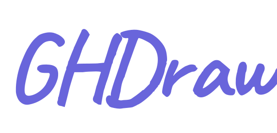

# GHDraw

A hand-drawn style whiteboard for the browser, inspired by Excalidraw. The source page works offline without a build; cloud sharing and AI require an explicit build target that injects the correct Appwrite Function endpoint.

<p align="center"></p>

## Demo videos

Watch short demos on the [GHDraw YouTube channel](https://www.youtube.com/@GHDrawofficial).

## Features

**Excalidraw-style interface**
- Floating top toolbar, a left properties panel, zoom and undo/redo controls at the bottom, and a hamburger menu
- Tools: selection, hand (pan), rectangle, diamond, ellipse, arrow, line, pen, text and eraser. Drawing tools always stay active until you choose another tool or press Esc
- Select, move, resize (with Shift to keep proportions) and multi-select with a marquee or Shift+click
- Infinite canvas: pan with the mouse wheel, `Space` + drag or the hand tool; zoom with `Ctrl` + wheel or the +/- buttons. Every time the app opens, each page starts at exactly 100% zoom (the view keeps its center, so you stay where you were); zoom changes made during a session are kept until you reload.

**Styling**
- Stroke and background colors (Excalidraw palette plus a custom color picker)
- Fill styles: hachure, cross-hatch, solid
- Stroke width, stroke style (solid, dashed, dotted), sloppiness (hand-drawn wobble), sharp or round edges, opacity
- Layers: send to back, backward, forward, to front
- Duplicate, delete, copy and paste

**Text with lots of fonts**
- 32 font families in the text tool, each previewed in its own typeface in the picker: handwriting (Caveat, Kalam, Patrick Hand, Shantell Sans, Playpen Sans, Pangolin, Caveat Brush, Amatic SC), script and display (Marck Script, Kaushan Script, Dancing Script, Pacifico, Merienda, Courgette, Lobster, Bangers, Fredoka, Baloo 2, Righteous, Comfortaa), sans (Nunito, Poppins, Inter, Rubik, Oswald), serif (Playfair Display, Lora, Merriweather, Abril Fatface, Cinzel) and mono (Courier Prime, Roboto Mono, Space Mono)
- Font size presets plus a free size field, left/center/right alignment, multi-line text
- Double-click any text to edit it. Turkish characters (ğ ş İ ı ö ü ç) render correctly

**Everything else**
- Dark mode, optional grid, Turkish and English interface (switch in the menu)
- Sticky notes, comment pins, live cursors and chat, board history, installable app (see New in v10)
- Export to PNG (2x) or animated PNG, animated GIF, MP4 / video, PDF (all pages), SVG (vector), each with a progress bar; save and open `.ghdraw` files
- Autosave to `localStorage`; shared rooms also keep a durable local snapshot and retryable sync outbox in IndexedDB
- Offline drawing uses vanilla JS and works directly from `file://`. Cloud and AI requests are disabled in the unbuilt source; deployable cloud builds must select an explicit endpoint target.

> The fonts load from Google Fonts, so the font picker needs an internet connection. Without it, text falls back to a system font.

## Keyboard shortcuts

| Key | Action |
| --- | --- |
| `V` / `1` | Selection |
| `H` | Hand (pan) |
| `R` / `2` | Rectangle |
| `D` / `3` | Diamond |
| `O` / `4` | Ellipse |
| `A` / `5` | Arrow |
| `L` / `6` | Line |
| `P` / `7` | Pen |
| `T` / `8` | Text |
| `E` / `9` | Eraser |
| `N` | Sticky note |
| `M` | Comment pin |
| `Ctrl+Z` / `Ctrl+Shift+Z` | Undo / redo |
| `Ctrl+D` | Duplicate |
| `Ctrl+C` / `Ctrl+V` | Copy / paste |
| `Ctrl+A` | Select all |
| `Ctrl+S` / `Ctrl+O` | Save / open a `.ghdraw` file |
| `Ctrl+Shift+E` | Export PNG |
| `Delete` | Delete selection |
| `Shift` while drawing | Square, circle or 45 degree line |
| `?` | Show shortcuts |

## Run locally

Clone the repo and open `index.html` for offline/local drawing. The unbuilt source intentionally has no cloud endpoint. To exercise cloud features against the test Function, build the test target and serve that output over HTTP:

```bash
git clone https://github.com/GokalpHizmetleri/GHDraw.git
cd GHDraw
open index.html   # offline/local drawing only
node scripts/build.mjs --target test
python3 -m http.server 8080 --directory dist/test
```

## Build and deploy to Vercel

Cloud-enabled builds must use the endpoint build script; publishing the repository root or raw `index.html` leaves cloud and AI features disabled.

For a local test artifact:

```bash
node scripts/build.mjs --target test
```

This writes `dist/test/` and always selects the isolated test Function. A production artifact requires the **actual newly provisioned production Function URL**:

```bash
GHDRAW_CLOUD_PRODUCTION_ENDPOINT="https://<function>.<region>.appwrite.run" node scripts/build.mjs --target production
```

The production build fails before writing output if the variable is missing or invalid, or if it points to the test or retired Function. Do not replace the placeholder with a guessed URL. No production Function URL is currently provisioned for this rollout.

[](https://vercel.com/new/clone?repository-url=https://github.com/GokalpHizmetleri/GHDraw)

The repository's [`vercel.json`](vercel.json) runs `node scripts/build-vercel.mjs` and publishes only `dist/vercel/`:

- On **Production**, Vercel's `VERCEL_ENV=production` selects the production build and requires `GHDRAW_CLOUD_PRODUCTION_ENDPOINT` in the Vercel project's **Production** environment.
- On **Preview** and **Development**, the wrapper explicitly selects the test endpoint; it ignores the production endpoint variable.
- Ensure Vercel system environment variables are available to the build so `VERCEL_ENV` is present. Missing or unknown values fail closed.
- Do not override the build command or output directory to publish the repository root. Production deployments remain blocked until the new Function exists, its endpoint is set, and the release preflight—including scheduled cleanup evidence—passes.

For details on endpoint selection and the cleanup release gates, see [backend/DEPLOYMENT.md](backend/DEPLOYMENT.md).

## How it works

- Every shape, stroke and text block is a plain JSON element in an ordered list (the order is the layer order).
- Rendering draws that list onto a `<canvas>` through a pan/zoom transform. Undo and redo move through snapshots of the list, and export draws the same list onto an offscreen canvas.
- The hand-drawn look comes from drawing each shape twice with small seeded offsets, so lines wobble without flickering between frames.
- Autosave serializes the element list, view and style defaults to `localStorage` on every change. During cloud collaboration, the app also stores the room snapshot and an in-flight update in IndexedDB before sending it. The same operation ID is retried after a lost response; the backend acknowledges duplicate requests and returns a monotonically increasing room revision. Joining backs up the previous local board and rebases edits made since that device's last checkpoint onto the latest room state. A history restore first waits for every durable outbox operation to receive its authoritative ACK, then stores a restore intent and stable `restoreId` before contacting the server. The backend retains a matching restore receipt, so a lost response is retried idempotently instead of repeating or losing the restore. On success, the new checkpoint, receipt ID and local snapshot are persisted in one IndexedDB transaction with a monotonically increasing room generation before clearing the local safety marker; stale-generation tabs cannot post, checkpoint or snapshot old state. The generation is recorded with the local board, and a reload quarantines an older board in recovery backups instead of treating it as private data. Sync, join and restore use a per-room Web Lock across tabs; browsers without this lock fail closed rather than risk racing durable checkpoints or outbox writes. If a required quarantine backup fails, joining stays blocked until the exact raw record is archived or a recovery `.ghdraw` is downloaded; that file imports the latest in-memory board and embeds the quarantined original. The export authorizes only those board contents: later edits require a fresh durable backup or export, and the app rechecks protection immediately before replacing any board snapshot.
- Live chat writes its outbox to a dedicated IndexedDB store. Each enqueue, retry-state update, and per-message ACK removal reads the current room queue in a `readwrite` transaction and verifies the committed result before any message POST; Web Locks add coordination where available, while the IndexedDB transaction remains the cross-tab atomicity boundary. If storage cannot commit, sending pauses and the draft stays in the input. A room has one shared **9,400-receipt budget** for board operations, history restores, and chat sends (not 9,400 per feature); the backend rejects a new send at the limit without mutation but still ACKs retries of an already receipted message. Chat idempotency receipts are private and expire with the room; the visible chat window remains limited to the newest 100 messages.
- Before enabling the scheduled expiry cleanup, complete the [`expiresAt` index preflight](backend/DEPLOYMENT.md). The required ascending DateTime index must be ready on the exact Function target (`ghdraw.boards-test` for test, `ghdraw.boards` for production); a failed expiry query returns 503 rather than reporting cleanup success.

## Files

| File | Purpose |
| --- | --- |
| `index.html` | The whole app: markup, styles and drawing engine |
| `backend/shared/board-element-contract.js` | Versioned element validation shared by browser and backend; cached in the offline app shell and included with the Function source |
| `sw.js`, `manifest.webmanifest` | Installable app (PWA) and offline app shell; the icons are embedded in the manifest as data URLs |
| `logo.svg` | Wordmark ("GHDraw" in the Caveat handwriting font) |
| `LICENSE` | MIT |

## License

MIT - see [LICENSE](LICENSE).

## New in v3

- **Collaborate (ortak çizim):** start a session and send its short link. Changes sync through the free Appwrite backend about every 4 seconds, across all pages. The host does not need to stay online. Sessions expire after 48 hours; there are no live cursors or participant counts in cloud mode.
- **Shape library:** press `B` or use the toolbar button. Flowchart, UML and icon sets. Click a shape to place it, then move or edit it. Shapes come in groups: `Ctrl+G` groups, `Ctrl+Shift+G` ungroups.
- **Mobile and pen:** two-finger pinch to zoom and pan, double-tap text to edit, bottom toolbar on small screens. Stylus pressure changes pen stroke width, and while a stylus is in use, finger touches pan instead of drawing (palm rejection).

## New in v4

- X buttons close the properties panel, shape library, menu, and dialogs. Closing properties does not change the current tool; select a tool again to reopen it.
- Drawing tools always stay active after drawing. There is no lock toggle or Q shortcut; choose another tool or press Esc to return to selection. Typing names, search queries or other input fields no longer triggers tool shortcuts. Double-clicking empty space no longer unexpectedly switches to text.
- The welcome logo/text sits behind the drawing surface. Peer names and cursors have a separate overlay above drawings, images, videos and floating tool panels (dialogs remain on top).
- **Media** (the picture button or menu): upload PNG or GIF files from your device (4 MB each). Move, resize, duplicate, delete, set opacity, and reorder media and shapes. GIFs animate on the board. There is no online GIF/meme search and no third-party media API: nothing is fetched from an external provider. JPEG/WebP/video uploads are not accepted; boards saved earlier with those still open.
- Uploaded media is embedded in board data. Older boards that contained online-GIF elements (stored only as an id) show a dashed "GIF removed" placeholder, which you can delete.
- PNG export works for drawings and uploaded images/GIFs. If the board has animated GIFs, export produces `ghdraw-animated.png` (APNG, animated in browsers and most viewers; up to 10 s and 100 frames, so long GIFs are sampled). This needs a browser with the `ImageDecoder` API (Chrome/Edge, recent Safari/Firefox); otherwise the GIF exports as a single frame.

Uploaded media stays local until you create a cloud share or collaboration link; those actions upload the board and media. Cloud collaboration polls every 4 seconds while the tab is visible. Older PeerJS links are legacy only.

## Media update

The GIPHY/Wikimedia Commons online GIF search was removed; only PNG and GIF uploads from the device are accepted. Old v4 video elements still render for backward compatibility, without enabling new video uploads.

## Tool lock and grid update

- Drawing tools always stay selected after shapes, pen strokes and text entries. The lock button and Q shortcut were removed.
- The grid now has its own background canvas below all drawings and uploaded media, in both light and dark mode. Selection handles and live drawing previews remain above the scene.

## PDF export

Choose **Export > Export as PDF**, or the PDF item in the hamburger menu. Downloads `ghdraw.pdf`: the full board fitted to one custom-sized page, without the grid or editing controls. GIFs are static; for animation choose PNG/APNG instead. PDF is raster (JPEG at 95% quality), not editable vectors. Large boards are scaled to at most 8 million pixels and 8192 pixels per side to keep mobile memory use bounded. All PDF generation happens locally, with no extra dependencies.

## Animated GIF export

Choose **Export > Animated GIF** for a gallery-friendly `ghdraw-animated.gif`. Requires an uploaded animated GIF and browser GIF frame decoding (`ImageDecoder`, tested in Chrome). Full board, white background, looping, up to 10 seconds at 10 fps, longest side 480 pixels, fixed 256-color RGB332 palette. This trades color fidelity and resolution for mobile memory use; text and line art may look softer, and the simple encoder makes bigger files than optimized GIF encoders. PNG/APNG stays available for higher quality. PDF cannot animate.

## MP4 / video export

Choose **Export > MP4 / Video**. Browser-supported MP4 (H.264) is preferred; browsers that cannot record MP4 download an honestly named `.webm` instead. Requires an uploaded animated GIF and GIF frame decoding. Silent single-pass video, up to 10 seconds at 20 fps, longest side at most 1280 pixels (even dimensions), white background, no grid. Keep the tab visible during real-time recording. Encoding support varies by browser/device; no video upload was added.

## New in v7

- **Pages:** the bar at the bottom center holds page tabs. `+` adds a page, click the active tab (marked with a small arrow) for rename, duplicate, move and delete. Each page keeps its own view and undo history. Pages are saved in the browser and in `.ghdraw` files. Cloud collaboration supports adding, renaming, duplicating, deleting and switching pages. Page reordering is disabled during collaboration.
- **Smart arrows:** an arrow or line whose end is drawn on a rectangle, diamond, ellipse, text or image attaches to it and follows when the shape is moved or resized. Select an arrow and drag a round end handle to re-attach or detach it (a filled handle means attached). Moving the arrow itself detaches it. Copy, duplicate and library save keep attachments between the copied shapes.
- **Own shape library:** the **Mine** tab in the library (`B`). Select shapes, press **Save selection** (or the library button in the properties panel), name it, and reuse it any time. Hover or tap the x on a tile to delete it. Stored in the browser only (images and videos are not saved).
- **Presentation mode:** menu > Present, the play button next to the page tabs, or `Ctrl+Shift+P`. Add **presentation frames** from the menu (each frame is a 16:9 dashed box with a number); every frame is one step. Pages without frames are one step showing the whole page. Arrow keys, Space, Enter, tap (left third goes back) or swipe move between steps, Esc exits.
- **Read-only share link:** menu > Read-only link. A short `#share=...` link stores all pages and media in the backend and expires after 7 days. The viewer can pan, zoom, switch pages and present, but cannot change the stored snapshot. Copy to my board backs up the previous local board. Legacy self-contained `#view=...` links still open, but cannot expire or be revoked.
- **Export menu:** PNG / animated PNG, animated GIF, MP4 / video, PDF and SVG. A progress bar shows while a file is prepared. PNG, GIF and SVG use the current page; PDF includes every page. Video has its own page and transition settings.
  - **SVG:** real vector output with the same hand-drawn look. Fonts are referenced by name and loaded from Google Fonts when the SVG is opened online.

## New in v9

- **Page video:** choose all pages or the current page, 1-10 seconds per page, and none / fade / slide transitions (0.5 seconds). One-page boards export directly without a page/transition dialog (3 seconds). Static drawings no longer need an animated GIF to export video. Silent 1280 x 720 output, maximum 120 seconds, MP4 where supported and WebM otherwise. Embedded video/audio is excluded. Keep the tab open throughout recording.
- PPTX export and its browser-side writer have been removed. PNG / animated PNG, GIF, video, PDF and SVG remain. Presentation mode and presentation frames still work.
- Tool settings use a narrower 200 px desktop card with less spacing. On phones the card is at most 292 px wide and 32% of the viewport height, with scrolling for the remaining settings. Touch controls keep at least 44 px targets.
- The main menu is capped to the dynamic viewport height and scrolls vertically; rows keep their full height. Dialogs also fit the available screen height, including short landscape screens.
- The shape library popup is narrower too: 240 px on desktop, up to 280 px on phones.

## New in v10

- **Sticky notes** (tool `N`, toolbar): click to place a note, type text, pick one of five colors. Double-click (double-tap on a phone) to edit. Notes are normal shapes: move, resize, recolor, and arrows attach to them. The author name is shown on the note.
- **Comment pins** (tool `M`): click to drop a pin and start a thread. Click the pin to read and reply, resolve or delete it. Pins show on the canvas only; they are left out of PNG, PDF, SVG and video exports and of presentation mode. Replies in a shared board are appended on the server in arrival order, so two people replying to the same pin at the same moment both keep their message (merged by message id).
- **Live presence in shared boards:** colored avatars show who is connected, and each person's cursor with their name appears on the page they are on. A chat panel (speech bubble next to the avatars) keeps the last 100 messages of the room. Presence and chat use a small extra private row per room with the same 48 hour expiry; they refresh about every 1.5 seconds with other people present (4 seconds when alone, paused in hidden tabs).
- **Smart arrows** already existed (v7): arrow ends attach to shapes and follow when the shape moves. Unchanged in v10.
- **Board history:** menu > Board history. In a shared (cloud) board the server keeps the 20 newest versions of the whole board for the room: one is taken automatically after a change when at least 2 minutes passed since the last, plus "Save a version now". Restoring saves the current state first, then replaces the shared board for everyone. The history lives in a side row of the room and expires with it (48 hours); deleting the room deletes it too. Caps: 20 versions, 8 MB compressed in total, 3 MB compressed per version (a larger version is not stored). Boards that are not shared have no server session, so they keep the 20 newest versions in this browser (IndexedDB) instead.
- **Install as an app (PWA):** `manifest.webmanifest` (icons embedded as data URLs, so no binary files) and `sw.js`. Chrome and Edge offer Install in the menu; on iOS use Share > Add to Home Screen. The app shell and fonts you already loaded open offline; creating or first opening a cloud link, live presence/chat and not-yet-loaded fonts need a connection. A collaboration room already opened on this device can be reopened offline and edited; changes are kept locally and retried when the device reconnects. The service worker never caches Appwrite data.

## Cloud backend

New read-only links expire 7 days after creation; collaboration rooms expire after 48 hours. The server checks its clock on reads and edits, and an hourly cleanup runs at minute 17. Expiry prevents new server access, not screenshots, downloads or copies already held in a browser. Anyone who has a room link can edit it: keep it private. A read-only link is a bearer link, not a password-protected document.

The backend now uses Appwrite **TablesDB** (`ghdraw` database, `boards` table) via `node-appwrite` 29.x. The table and its rows must have no public permissions; every row the Function creates is explicitly given an empty permission list. Anonymous share/view/room requests go through the public-execution Function only—the browser never connects directly to the table. Runtime Function scopes are limited to `rows.read` and `rows.write`; Appwrite supplies a short-lived per-execution key, and no persistent Appwrite service key is shipped in the frontend or repository. `GROQ_API_KEY`, when enabled, remains a Function environment secret. `/create` returns a private owner token for optional DELETE `/owner/:id`; public reads omit it. Collaboration hosts keep their revocation token in localStorage.

Bounds: 12 MB JSON board/request, 100 pages, and 150 stored share links for the whole project; private presence, chat, history, lock, create-receipt, room-operation-receipt, room-quota and AI-quota rows are not counted. The backend reads only `$id` and `expiresAt` for capacity and cleanup scans, never board payloads. Cleanup filters by a fixed expiry cutoff, repeatedly re-queries the first matching page (no offset or mutation-sensitive cursor), deletes ordinary rows in Appwrite's maximum 100-row bulk batches, and rechecks expiry in the delete query so a row renewed after listing stays active. Each invocation is capped at 1,000 scanned rows, 25 transactional lock/AI-row checks, 10 pages, and a 20-second elapsed-work budget checked between database operations; later hourly invocations safely continue from the remaining expired rows, including rows inserted while a prior page was being deleted. Share and room creation use a serialized capacity check plus a private idempotency receipt, so a retry with the same request ID returns the original link. Every non-empty room mutation must include a valid `opId`; its deterministic private receipt and the bounded room quota row (up to 9,400 receipt row IDs) are written in the same transaction as the board revision. Duplicate receipt lookup occurs before the hard per-room cap, so lost-ACK retries still return their original ACK even after the cap; new operations are rejected before board/revision mutation and the user is directed to create a new room. Legacy `d.ops` IDs are also acknowledged before quota checks. Receipts are never silently pruned during a room's 48-hour lifetime. Owner deletion holds the room lock and removes all indexed operation receipts in bounded batches within the same transaction as the room, quota, presence, history and creation-receipt deletion; an incomplete ledger fails closed instead of leaving an untracked receipt trail. Existing legacy `ops` arrays are still recognized, but this branch does not migrate old project data. Board history goes through POST `/hist/:id` (list, save, get/export, restore); a cloud history restore immediately persists its matching base/revision checkpoint while preserving any in-flight operation ID, and fail-closed rejoin prevents a stale checkpoint from overwriting newer work if persistence fails. The app also supports board-file export/import and local recovery of the private board. Local collaboration backups are capped at four copies, 512 KiB each and 1 MiB total; a failed backup never evicts an older copy. Use menu > **Manage local board backups** to select and confirm a deletion when freeing space. Locally saved camera positions are clamped to the validator's safe range; offline room snapshots preserve text geometry, and older snapshots are remeasured before application. These recovery paths are app-level safeguards, not a database backup service. **Appwrite Free does not provide daily automatic database backups.** Export important boards from GHDraw and keep the exported files separately; room history is limited to 20 versions / 8 MB compressed and expires with each room (48 hours). No upgrade or paid backup service was selected.

The migration target is a fresh, blank TablesDB project being provisioned separately. The inaccessible old project was not read, migrated or deleted; no old data is claimed to have been transferred. The frontend Function URL remains a release-specific setting and will not be switched until the new Function is provisioned and passes live verification. This branch must not be published before that check.

**Free-plan availability:** Appwrite pauses Free projects after 7 consecutive days without development activity in its Console. Normal user traffic does not guarantee that a project stays awake. While paused, links and rooms are inaccessible and scheduled cleanup stops; data remains and the project can be reactivated in the Console. Continuous availability requires a different hosting choice or a paid plan, neither enabled here. Policy: https://appwrite.io/changelog/entry/2026-02-20-1

Once provisioned, the Appwrite project will be managed under a separate Agent-owned account. Account credentials and runtime keys are kept outside this repository. The project remains private, and there is no ownership or data transfer from the old account.

### Deploying your own copy

1. Create a private TablesDB database `ghdraw` and table `boards` with a required `longtext` column `payload` (at least 16,777,216 characters) and a `DateTime` column `expiresAt` (it may be nullable; the Function populates it for every row). Create a key index on `expiresAt` (ascending) so bounded cleanup queries do not require full-table scans. Keep table and row permissions private.
2. Create a Node.js 22 Function, entrypoint `src/main.js`, with public execute permission `any`, runtime scopes `rows.read` and `rows.write`, cron `17 * * * *`, and set its Timeout setting to **30 seconds** (strictly below the fixed-row lock lease of 60 seconds). Verify this configured value before release; do not deploy with a longer timeout. Appwrite documents a system maximum of 900 seconds, so this shorter setting is a required safety constraint, not an assumed platform default. The Function uses Appwrite's `APPWRITE_FUNCTION_API_ENDPOINT`, `APPWRITE_FUNCTION_PROJECT_ID` and per-execution `x-appwrite-key`; do not add a long-lived Appwrite key to code or frontend. Keep `GROQ_API_KEY` as a secret environment variable if AI tools are enabled.
3. Deploy the files under `backend/` including `package.json`, `package-lock.json`, `shared/package.json`, `shared/board-element-contract.js`, `src/main.js`, `src/ai.js` and `src/room-sync.js`.
4. After the Function domain is known, set the frontend `CLOUD` URL to that domain and preserve the `https://ghdraw.vercel.app` CORS origin. Do not publish until anonymous share/view/room, private-row denial, history export/restore and scheduled expiry cleanup have passed against the live project.

### Collaboration limits

Concurrent edits to different elements are merged transactionally; editing the same element uses the last accepted update. Cloud sync is periodic, not instant. A room opened on a device keeps an IndexedDB snapshot and durable in-flight outbox; reconnect retries the same operation ID, and reopening rebases local edits onto the latest server revision. Hidden tabs pause sync and refresh on return. Page order stays fixed during a room. Undo history resets after remote changes so an old snapshot does not overwrite peers. Validate touch, stylus, safe-area and PWA behavior on actual iOS/Android devices before claiming hardware coverage.

### AI text correction

Select one text block, then choose **Fix spelling & grammar** in its properties. Read the data warning, then use **Send & preview**. Nothing on the board changes until **Apply to text**. Undo restores the old text. If the source text or page changes while the request runs, applying the stale result is blocked. Read-only boards have no AI controls.

Only the selected text (1-2000 characters) and a random client identifier for rate limits are sent to Groq and Appwrite, respectively; the board and other elements are not sent. AI can change meaning or make mistakes, so review the preview. Do not submit personal, confidential or sensitive information. Groq's data policy: https://console.groq.com/docs/your-data . The app stores only quota counts and keyed client hashes, not AI input/output text. Provider processing and Appwrite execution metadata have their own policies; no claim of end-to-end secrecy is made.

The app has no login, so limits are **per browser installation**, not per verified person: 20 requests/day and 1 request every 3 minutes (a rolling 180-second wait between requests, also across minute boundaries and midnight UTC), plus a site-wide 200/day and 10/minute ceiling. Daily limits reset at 00:00 UTC. Appwrite custom domains omit the documented client-IP header, so the fallback uses a random browser identifier. Clearing browser storage bypasses its individual cap; it is not verified-user protection. A 429 response includes the remaining wait in seconds; the interface shows it in Turkish or English. Quota is reserved before the provider call; failed provider calls can count. Global caps protect the provider allowance even if clients reset browser identifiers. The free provider and Appwrite quotas can still stop requests.

Deployment: include `backend/src/ai.js` with `main.js`, and add `GROQ_API_KEY` as a secret Function variable. Do not put the key in this file, the frontend, or GitHub. The chosen model is `openai/gpt-oss-20b`; model availability and free quotas can change. Run `npm test` from `backend/` for the endpoint, storage, cleanup and quota regression suite. A missing key fails closed, never calls a paid alternative, and never changes the drawing. No card, upgrade or paid overage is enabled.

## New in v13: templates, emoji and icons

Open the shape library (**B** or the menu) and pick a tab:

- **Templates:** flowchart, meeting notes, kanban board, mind map, SWOT and roadmap. A template inserts normal editable shapes and text, not an image. Each box and its label are grouped (double-click the label to edit the text, **Ctrl+Shift+G** to ungroup). Flowchart and mind-map connectors are bound to their shapes and follow when you move them. The view zooms out if the template is larger than the screen. Templates are inserted on the current page and sync in shared rooms like any other shapes. Labels follow the interface language when inserted.
- **Emoji:** about 190 emoji in 7 groups with search (Turkish and English words, e.g. "kalp", "heart", "ok"). Pick Small, Medium or Large (large works as a sticker). Each emoji is inserted as an editable text element, so you can resize, recolor-opacity, copy and move it like other text.
- **Icons:** the existing icon tab now also has calendar, folder, bell, flag, page, search, checkbox, play, plus, block arrow, cup and rocket. They are drawn from GHDraw's own shapes.

Everything works offline once the app shell is cached. No external service is called.

**Licensing:** emoji are plain Unicode characters. No emoji image set, icon font or third-party artwork is bundled, so there is nothing to attribute. The glyphs are drawn by your device's own emoji font (Apple, Google Noto, Segoe), so they look different per platform. Emoji your system cannot draw are hidden from the picker. Templates and icons are original to this project and covered by the MIT license.

## v14: mobile emoji picker fix

The emoji grid now stays inside the picker with its own scroll area. Columns adapt to the available width, with 44px buttons instead of eight cramped columns. The mobile emoji panel has enough room for its controls and grid; short screens can scroll the panel. New emoji use the system sans-serif/emoji fallback rather than the current handwriting font. Existing boards are not changed.

## v15: floating utility widgets

Open the menu to add a **Clock**, **Calendar**, **Timer** or **Checklist** panel. Drag a panel by its title bar; close it with the × button. The checklist is saved in this browser and is separate from the drawing board. On narrow screens, panels open with staggered title bars so one widget does not completely cover another; each panel can still be moved freely.

## v16: offline collaboration and mobile/tablet polish

- Collaboration rooms already opened on a device can be reopened and edited without a network connection. Local board snapshots and a pending operation are stored in IndexedDB; queued writes are persisted before sending, carry an operation ID and base revision, and retry unchanged after a timeout or page restart.
- Room writes and history restores are idempotent and return an ACK and monotonically increasing revision. A reconnect or app resume fetches the latest server board, rebases local changes, then retries; stale revisions are applied transactionally on the latest room state. Operation and restore receipt IDs are retained for the room's lifetime; if the receipt quota is reached, a new mutation is rejected before commit rather than pruning IDs and allowing an old retry to replay.
- A compact sync badge distinguishes offline, pending, syncing and local queue-storage errors. The app retries on reconnect and when a hidden tab becomes visible. Existing localStorage autosave remains the fast local recovery path.
- Mobile/tablet layout uses dynamic viewport sizing, safe-area insets, larger touch targets and a visible collaboration/sync control cluster. Short landscape screens get a compact toolbar and panels.
- The new frontend and Appwrite function must be deployed together for server ACK/revision/idempotency guarantees. No live deployment was made for this change.

## v17: room isolation and safe-sync protocol guard

- The `localStorage` board record includes its `cloudRoomId`. Reopening a room uses that room's local board only when the identity matches; otherwise it selects that room's IndexedDB snapshot/checkpoint or the server board. A different private board is never diffed against a room checkpoint.
- If a stale-generation board cannot be durably archived, joining or sharing is blocked until storage is freed and the exact record is backed up, or the quarantined board and current live work are explicitly downloaded together as a `.ghdraw` recovery file. Restoring a confirmed private backup clears the stale-room guard; room-scoped backups remain generation-fenced.
- Before sending a pending write, the client verifies that the room endpoint returns the explicit sync-protocol version and a valid revision, including after reconnect and app resume. A write is acknowledged only when the server returns the exact operation ID and a valid, non-regressing revision.
- If the backend lacks the revision/ACK contract, queued changes remain local and automatic writes stop until the backend is updated and the page is reloaded. No live deployment was made for this fix.


### Collaboration receipt cap and Appwrite Free budget

Each 48-hour collaboration room has a hard **GHDraw application cap of 9,400 unique collaboration mutations with an operation or restore ID** (about 3.3 mutations/minute if spread evenly across the room lifetime); this is not an Appwrite per-room limit. A private per-room quota row tracks all operation and history-restore receipt row IDs; incrementing it, updating the board/revision, and creating the private receipt happen in the same database transaction. The server checks the receipt first, so a retry for an already-received ID still returns its original ACK at the cap. A new mutation at the limit returns HTTP `409` with `error: "room_receipt_limit"` and tells the client to create a new room; it does not mutate the board/revision. Older rooms without a complete trusted ledger fail closed for new unique mutations, while known receipt retries still receive their ACK. Receipt IDs are never silently pruned before room expiry. The client keeps the durable outbox and pauses retries after this explicit response. Owner deletion atomically removes indexed receipts using at most 94 bulk delete requests of 100 rows each, plus at most five single-row deletes. GHDraw chooses 9,400 so this single atomic delete transaction stays below Appwrite Free’s 100-operation transaction limit while removing all receipts; incomplete ledgers fail closed and preserve the room.

The [Appwrite Free database-operations documentation](https://appwrite.io/docs/advanced/billing/database-reads-and-writes) currently lists **500,000 reads and 250,000 writes per month**; the [Free-plan documentation](https://appwrite.io/docs/advanced/billing/free) says resources are shared at the organization level and no additional Free-plan resources can be purchased. Appwrite counts affected rows, not API calls: row reads/list results count as reads, row create/update/delete as writes, and an empty query still counts as one operation. Each accepted unique collaboration operation writes the board row, quota row and receipt row, in addition to lock-row writes; cleanup later deletes expired receipt/counter rows. The [TablesDB bulk-operation docs](https://appwrite.io/docs/products/databases/tablesdb/bulk-operations) cap Free requests at 100 rows, and [TablesDB transaction docs](https://appwrite.io/docs/products/databases/transactions) cap Free transactions at 100 staged operations. Appwrite does not impose the 9,400 per-room number: GHDraw selected it as an application policy so one atomic owner-delete transaction can remove at most 94 bulk batches plus five fixed rows (99 staged operations); a 10,000 cap would require a multi-transaction deletion design for this cleanup path. This is a hard safety ceiling, **not** a guarantee that the monthly organization quota will last. Monitor the organization Usage tab and revisit the cap using actual room activity and quota use. No paid plan or overage is enabled.
